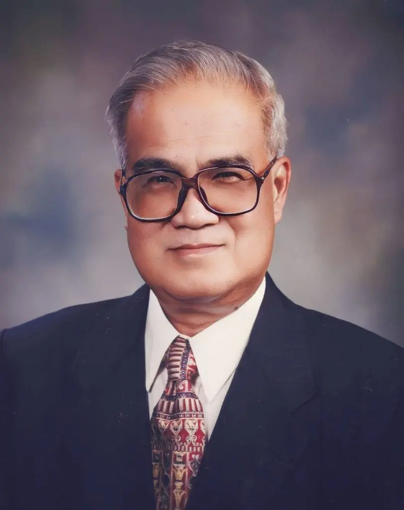

Khoo Chong Guan 1937-2023

I don't feel quite ready to write something about my father-in-law. I want to write about how I will miss bathing him every morning, about reminding him which is the front facing part of his trousers as he puts them on, about how he is ever so polite to say "Thank you!" after each shower, about how it has been such a privilege to cook for him, cos he would always make it a point to finish what is put in front of him, no matter how bad the chef, for such is the man he is, full of heart and happiness.  

Speaking of heart, perhaps I can talk about how he was saved from a major heart attack 18 years ago when he visited us in Nebraska during Chris' birth, where he was heli-lifted and resuscitated more than thrice in the air. Or that his heart was saved even earlier on through an open heart surgery by the late Dr Victor Chang in Sydney 50 years ago. In both occasions, his heart was patched up. This time round, his heart finally gave way due to COVID-induced pneumonia. His heart has weathered much, having beaten the odds and medical predictions by more than 50 years. So it is definitely not a loss, but a victory, especially so since his heart is now in a better place, a treasure in heaven, where things don't rust and moths can't get to. Though his ashes lies here, he is finally, fully safe in the arms of Christ.

There remains much to be said, but perhaps most of them are best reserved for a reminiscing when we meet again in heaven. So for now, of all the things that I want to say, the most important one is, "I'll see you on the other side. Thank you for sharing your time with us while here on earth. It's been such a privilege to call you "Dad"."

What I shared at the cremation service:

有人说这一刻是一种哀喜。哀，因为宴席散了，心爱的人离了，而告别终究是悲伤的。可是在这一切当中，身为基督徒，死亡也只不过是永生的一站。因为耶稣的牺牲，我们对这世界短暂的人生有了永生的希望。耶稣从死里复活， 证明了他是死亡的胜利者，是永生的使者，是永爱的根源。我们基督徒死后所去的天堂，不是考自己的本能或善意所取。我们都是上帝的绵羊。羊群都需要牧羊者的领导。耶稣就是最好的牧羊者。就因为他是从天堂而来，对天堂的路，他是迷不了的。所以，对我们基督徒来说，今日死亡的一站，已变成了充满喜悦的告别。Dad知道他的下一站在何处，也深信他牧羊者的带领。Dad，你先走了。我们下一站和你再见吧。Bye for now。
