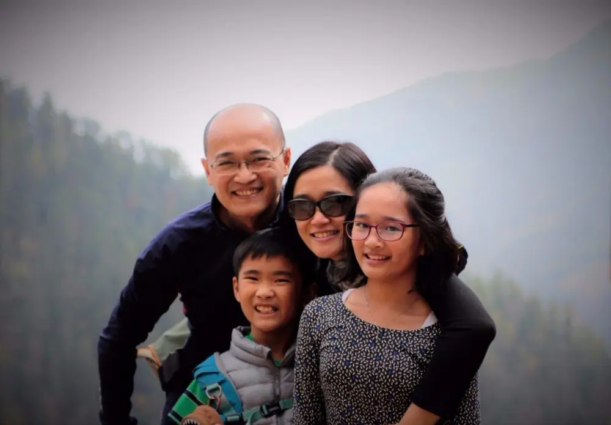

 Adrian and his family

### ABOUT ADRIAN

Who is Adrian Chan? Perhaps more of a quirk than anything, is that I keep an arm’s length away from money. It is not that I have a grudge against money. Money is useful and much needed. But money can define a person so strongly that it imprisons one’s sense of self into a comfortable cocoon (especially if you are rich), or propels one’s energies into an endless quest for self-validation (especially if you are poor).

I have experienced enough material comfort to realise that money truly isn't everything. I have also experienced enough hardship and material deprivation to realise that to be in want isn’t always a bad thing, for it prunes our lists of supposed needs to reveal only the essentials.

### ABOUT THIS BLOG

This brings me to why I have set up this blog. In my consulting and coaching work, my available time is directly translated into billable accounts. As an independent consultant, time literally is translated into money. To be conscious about time is a business requirement, a part of the financial accounting process. But it also means that any remaining time I have to myself can become a money trap if I use it to think about how to have more billable time.

To be a better steward of time (and money), I invest my time in other things. This blog is one of those things.

Through this blog, I track my own spiritual growth as a child of God. Each entry is a snapshot of who I am and what I am going through at that point in time.

### USING MATERIAL FROM THIS BLOG

I also use this blog to better understand human behavior, starting with my own behavior and beliefs. Occasionally, I may share what I'm discovering about leadership and leadership development, or about the work I do as an independent consultant. If you find my posts useful, please feel free to use them for your personal development. If you plan to use them in an organisational or professional setting, or plan to repost in any form, please acknowledge the source by referencing this website.

### DISCLAIMER

All entries in this blog are invitations to further discourse. Take them for what they are, and feel free to [email me](mailto:adrian@adriansays.com) if you wish. If you do feel inclined to write, please be respectful of others. Don't feel offended if the values and views shared in this blog differ from yours. It's the diversity that makes the world a more interesting place. Having said that, I will not respond to emails sent with the aim of politicizing agendas, inflaming sensibilities or that are simply irrelevant to the aim of the post.

As an aside, any entry in this blog should not be taken as 'evidence' of Adrian's failings as if Adrian is an immutable, unchanging entity incapable of growth. That's a fixed mindset. If one day God wants me to be famous, I want to warn potential detractors against using an entry from ten or fifteen years ago as evidence that Adrian was such and such and must therefore remain such and such.

 

#### Thank you for visiting this website. I hope you find [Adriansays.com](http://adriansays.com) to be a mishmash of things, occasionally confusing, but definitely personal, and hopefully worth your time spent here.
