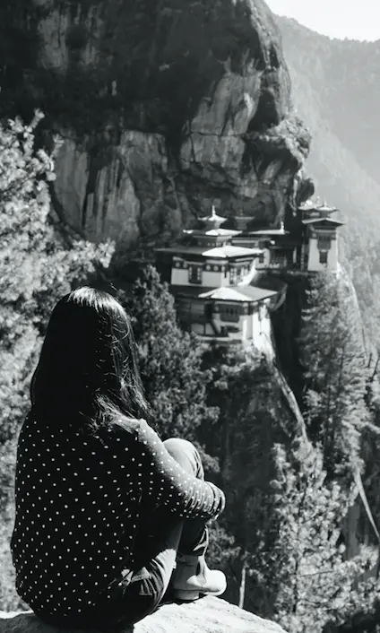

 Contemplating Change

# ***Change Happens Because Life Needs to Happen***

Change happens around and to us all the time. People say change is the only constant. I say change must necessarily occur, for it indicates that life is happening. For example, by this time tomorrow, we will be (hopefully) on a plane together with 19 accompanying luggages for our big move back to Singapore. In the days leading up to this day, so many changes have occurred to plans and intentions that I have lost count. Are we on economy? Or business? How much luggage are we allowed? Change in schedules of people wanting to meet up for final goodbyes. Change in what things to give away, things to sell, what can we bring back, what should we bring back. Because life needs to happen, change has to happen.

# ***Change is Changing***

Not only is change happening, but the nature and rate of change is also changing. Faster, more fluid change occurs as the countdown draws to a close. Instead of emails, we send messages through social media, and finally rely on the immediacy of phone calls. Instead of identifying days to meet up, we block out time down to the hour. Previously, we’d allocate types of things to give away to different groups of people. Now, each recipient has a personalised list. That change is changing is an indicator of the change in lifestyle we are experiencing from Bhutanese to more Singapore-like. In turn, this tracks the internal switch that I am making in anticipation of the life awaiting us in Singapore.

# ***Change is About Mourning***

Change is also accompanied by mourning. Each item we give away, sell or leave behind is a parting with the memories created here in Bhutan. Each farewell seems like a final goodbye no matter how much I tell myself it is not so. Still, it is a closing of a chapter, and deep inside, I know that well. The next time I come to Bhutan, it will be again as a visiting faculty. The things a visiting faculty can do will be drastically different from what a resident faculty can achieve.

Probably the deepest mourning I have is for the loss of the serenity that comes so easily in Bhutan. Sure, life can be hectic here in Bhutan as well. But the bursts of activity I allow myself is purposeful. In Singapore, purpose is more punctured by busyness, and peace comes perforated with obligations.

# ***Change is About Celebrating***

Over the past weeks, I have also experienced change as a form of celebration. Amidst all the packing, we find pockets of peace to reminisce about the memories created here in Bhutan. Whether it is a kitchen knife that has been with us since our time in Lincoln (more than a decade ago), or a farewell dinner with friends offering their impressions of us, I am realising that change is an opportunity for us to take stock of life that has occurred. After all, life is about change, and about to change.

# ***Purpose Drives the Impending Change***

Relocating back to Singapore is going to be tough, because it entails a remaking of the old me and the old life I used to lead. This is hard because back home, people expect the same old Adrian. But I am not the same Adrian anymore. Bhutan has changed me. Here are 3 areas I have been transformed.

## **Change in the Nature of Obedience**

Some of my army friends may still hold impressions of me saying “Yes Sir!” like an obedient soldier. With regard to obedience, I have learnt to obey a higher call to which even the King of Bhutan submits. This higher call transcends the confines of office. Instead, it defines how one’s office is carried out. Rank and station is meaningless in the hands of the inept. In the hands of the corrupt, it is pure evil. But in the hands of those truly obedient to a higher call, it is life giving.

In working with ministers and politicians, I have come to empathise with the tensions of political office. A political term can be frightfully short, or miserably long, depending on how and where it is viewed from. It can be an fearful stretch of one’s limitations, exposing oneself for all to see. It can also be a terrible balancing act of juggling too many glass balls in the air. But more than anything, politics is relentless in striving to cast one adrift from one's higher ideals. Those who hold firm against this incessant tide emerge polished and refined. Those who do not learn how to anchor oneself to a firmer foundation are washed out to sea.

Bhutan has taught me that obedience is a curious thing. We desire such a trait in our underlings, but then realise that leaders cannot be blindly obedient. As subordinates, we learn to execute the demands of each obedience. But as leaders, we learn that one too needs to be obedient. This flip flop of insight continues until eventually, we learn that the best leaders and subordinates are most discerning in what, who, when, and how they obey. Obedience is a school that requires wisdom to graduate.

## **Change in Notions of Spirituality**

Some of my church friends may still view me as who I was before I left for Bhutan, all ready to resume the duties which I relinquished when I left. But Bhutan has changed me. With regard to spirituality, Bhutan has taught me that it is not what one preaches, but how one lives out one’s beliefs, that counts for anything. To paraphrase A.W. Tozer, millions of Christians talk as if Christ is real and act as if He is not. The change I’ve experienced will express itself in what duties I perform and how I carry them out.

It is spirituality, not religiosity that ought to matter. Without a rich inner life that flows out to an outer life to enrich others, there is no spirituality. Without a generous love to all of humanity, and not just to those of the same religion, there is no spirituality. Spirituality unites, while religiosity divides.

The mark of religiosity is a pious outer shell that sheaths a rotten core. Against these, Christ himself condemns them as white-washed tombs. For it is not how often one goes to church, but how one practices the hospitality of God outside of the building, that determines one’s faith. In Bhutan, there is no church I can attend. This is not a limitation. Instead, it is an invitation for me to practice meaningful ekklesia with all of God’s creation. For a house that is not habitat to humanity is not a home at all.

Amidst the fog of the mountains in Bhutan, I saw clearly the difference between religiosity and spirituality. When one is alone on the mountaintop, in the presence of one’s God, without the facade of institutional religion, all forms of man-made idols are revealed for what they are and only the essential elements of one’s faith remains. There, on the mountain, one worships without the aid of fancy tunes or slick accompaniments. As my Buddhist friends prostrated and meditated, I too, fell in prostration and worshipped before my God and King. Spirituality is universal even if how it is expressed in Buddhism and Christianity may differ.

## **Change in the Nuances of Mealtime Conversation**

The third area I am learning to be different is in how I view meals. Singaporeans are foodies. Good food is essential for each meal. Good friends can be optional. In our hectic Singaporean lifestyle, meals with family after a long day at work are increasingly harder to come by.

I will have to be more deliberate about the purpose of each meal I have with friends and family. Sunday lunches after church, for example, will no longer be just lunch or about where to eat. Instead, it will center more around what to talk about, because that is what Bhutan has taught me to live out. Mealtimes at my in-law’s place or with my mom will no longer just be about showing up at the dinner table. The reason why I have to re-locate back to Singapore is because of aging parents. So each interaction with them must count for something.

# ***Change is Awaiting***

The 3 years here in Bhutan have been filled with adventure. Sadly, it is time to go back. But in returning, Singapore is now a new destination embarked upon by a new me. I will always be grateful for the time spent in Bhutan. It has left a mark on me. Thank you Bhutan.
