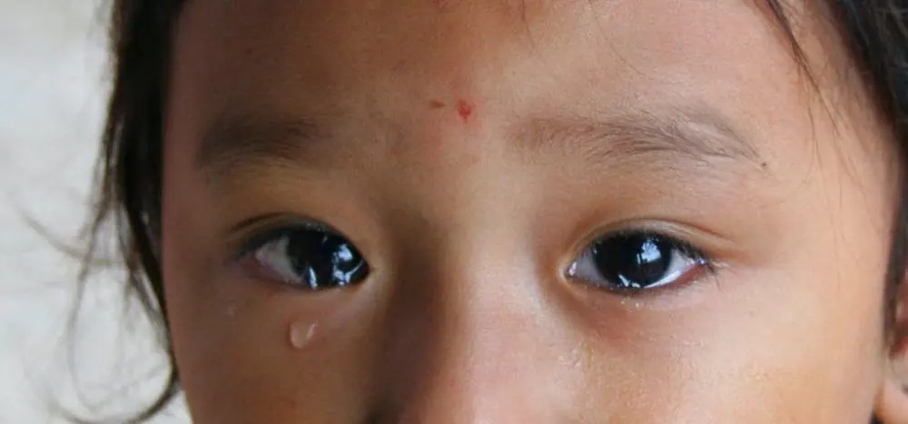

*Those who sow in tears will reap with songs of joy*. (Ps 126:6)
Picture courtesy of Pexels

You may have come across the term 'crucible moments'. A crucible is a container in which elements are subjected to high temperatures in order to create something new. In the same way, crucible moments are times of extreme duress that one undergoes. One emerges from these moments a new creation, like a phoenix rising from the ashes.

Now that I'm nearing 50, it occurred to me that my life is filled with crucible moments. Ethnographically speaking, I can derive from my life different types of crucible moments. I shall use the acronym TEARS to organize the moments. Each letter in 'TEARS' comprise a stimulus and a response. There is a start and an outcome as a result of the crucible process. With that, here is what TEARS stand for:

- Triggers and Turnings
- Effort and Encouragement
- Affliction and Affirmation
- Rest and Reflection
- Struggle and Surrender

## Crucible 1: Triggers and Turnings

### The Nature of Triggers

We first recognise that we are in a crucible moment when we are triggered. A trigger can manifest in many ways. It can be a harsh word, or even a kind one. It can be a stumble that one recognizes as a harbinger to a greater fall.

Regardless of how they appear, the role of triggers is to dislodge us from our comfort zones and current trajectories. It disrupts the momentum we have been maintaining. We are cruising along and all of a sudden, we are rudely interrupted.

### Let Us Turn and Re-Turn

We must recognise that triggers are not the enemy. The ones who supplied the triggering word or situation - they are not the enemies. I am sure there are people in our lives whose sole purpose for existence is (presumably) to trigger us. Stop thinking that way. Had we been successful in our previous response to them, they would no longer be triggering us.

The people or situations that trigger us - they hint at something within us that require change. Hence, the real danger is to ignore the triggers, to ignore the internal faultlines and resume our road to purgatory.

The correct response to a trigger is to turn. Or at least to stop and take new bearings.

To turn well is to recognise that we have a divine path we can 're-turn' to. We have shepherds in our lives we can turn to, who can help lead us in the paths of righteousness. And the crucible process is simply recognising that triggers require a turning, not a resisting or an ignoring.

## Crucible 2: Effort and Encouragement

### Extraordinary Effort

You know you are in a crucible moment when the situation requires extraordinary effort out of you. It can be when that first kid came along. Or when you received a major promotion or assignment at work. You put in herculean effort just to stay on top of things.

I remember when I had to put in work that was 'beyond my pay grade'. I was resentful that my seniors were not pulling their weight. When those seniors fired potshots at my effort instead of helping me, I felt 'thrown under the bus'. One of the seniors sensed my despondency and invited me to coffee. He said he understood how I felt. He then shared that it is common to put promising young officers through the grinder to see how well they respond to stress. It was an enlightening conversation, because I no longer felt victimised. I resolved not only to put in greater effort, but to also take ownership for the work as well.

### Be Encouraged, and Encourage Others

Persistence and [grit](https://www.ted.com/talks/angela_lee_duckworth_grit_the_power_of_passion_and_perseverance?language=en) are one of the hallmarks of success. Unfortunately, many of us are effort-avoidant. We want to run away from hard work. Instead, we should recognise that being asked to work hard is a great thing! There is no shortcut to success, really.

I was fortunate to have someone come alongside me when I needed it. We need encouragement in order to persist. In the old days, it was a common practice to anoint tired people with oil. The massaging, the aroma of oil, the act of consideration and care - these are all very visible ways to encourage others along when they are in crucible moments. How can we anoint others with oils (metaphorically speaking) when they are under duress?

## Crucible 3: Affliction and Affirmation

### Affliction and Suffering

One suffers when afflicted. It is painful! Yet without [suffering](https://adriansays.com/suffering-service/), it is impossible to become better.

For years, I've had eczema. Eczema can flare up with stress, poor sleep, unhealthy foods, dry weather, or simply due to bad genes. And for years, I've lamented why didn't I have healthy skin (I am superficial). I blamed the army for my skin condition (days without showers, working in sweaty, dusty uniforms). But I never took charge of the things that I could control. I could control my stressors, I can sleep better, and learn to eat better. I could exercise more. And I saw a traditional Chinese Medicine (TCM) practitioner to keep me accountable.

In working through my eczema, I came to realize that I needed to rid myself of unnecessary pride in how I appeared to others. I wanted to look good real bad, if that makes sense. Strangely enough, my skin only started to become healthier when I began to let go of my concern for my outward appearance. Coincidence? I think not. For afflictions are not there to torment us. Instead, they are divine rods and staffs to guide wayward sheep back to safer pastures.

### Affirmations amidst Afflictions

There is nothing like a good affliction to remove the dross from the silver. In my case, my eczema affliction was the process by which I shed dead skin from my superficial pride. At this moment, not only is a particularly stubborn patch of eczema gone, the value I place on my face is also gone.

Through this process, I realise that my face value goes beyond my face. Regardless of how one looks, we are all beloved children of God. And I have learnt that those who judge people solely by its cover are poor readers of what constitutes lasting value. As a result, I now try to take time to go beneath the surface to discern the true value of a person.

## Crucible 4: Rest and Reflection

### Rest from it all

A very special type of crucible moment is that of rest. It is almost antithetical to what crucible moments ought to be. But it is one nonetheless.

It takes work to arrive at a place of rest. This type of rest is spartan, monastic, not luxurious at all. In a previous post, I described it as a [desert](https://adriansays.com/desert/).

We arrive at this sort of rest not by choice. Sometimes, we are forced into it. For example, we may have been retrenched, become empty-nesters, or lost a loved one. When we arrive there, we become part of a special community who are familiar with such rest.

### Rest to Reflect

The objective of this type of rest is to [reflect](https://adriansays.com/reflect-journal/), to comtemplate, to meditate, and to [simplify](https://adriansays.com/simplicity/). We are led to still waters, to lie down beside green pastures. We sit and wait, to deconstruct and discover. And we give ourselves permission to be released from labor in order to restore our souls.

When we become acquainted with the nature of such rest, we may even start to intentionally enter into it. We realise taking time out to mourn, to unplug, to detox, to slow down, is not only a good thing - it is one of the best things we can do for ourselves and for others.

I try not to wait till something bad has happened before I embark on such rest. That would be too costly. These days, I try to carve out time in the mornings to reflect, typically over a nice cup of [kopi.](https://adriansays.com/kopi-scaling-up-being-adaptive/) It's less costly than waiting for disaster to strike!

## Crucible 5: Struggle and Surrender

### Struggling and Wrestling with the New

Some crucible moments arise out of happy occasions. For example, a job promotion can create a crucible moment. I struggled with my new identity each time I got promoted at work. I wrestled with what it meant to be a Leadership Resource Person in the King's office. When I was appointed as an elder in my church, I realised that the office meant a change in how I was to think, behave and lead. It was a wrestling of the old me with the new me.

### Surrender the old, put on the New

Much of the struggle I have is in surrendering my old self. I hate relinquishing. I am suspicious of the new, especially when it is all shiny and sleek.

When I retired from the army, it took me a long time to get myself out of the uniform, and to put on civilian clothes. I had to sift through what was worth retaining from the military, and what was not helpful to carry over to the civilian world. Likewise, when our family moved from Bhutan back to Singapore, we had to decide what to leave behind, what to transport back, and what to repurpose for a different use in Singapore.

Crucible moments are moments of similar relocations. We get to decide which aspects of our old selves to retain, which bits of the new to put on, and which portions to be modified for a different season. It's fun if you like spring cleaning. (I don't). It's hard work even if you like it. But the end result is always worth it.

## Crucible of Tears

Ultimately, crucible moments are tearful moments. On occasion, they may also come with blood and sweat as well.

If you find yourself in a crucible moment, rejoice! It's a once in a lifetime moment! And since you've already paid the price for it, make the best use of it. Get a coach to walk you through it. Find a friend to talk about it. Rest for a while as you ponder over it. Whatever you do, please don't waste it!
