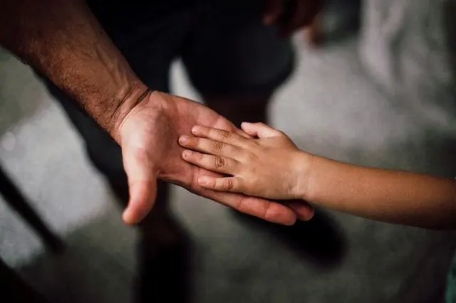

Father Child

*Have you a son to love, or a daughter to treasure?
Or are they lost to themselves, or even lost forever?*

*Have you a father to hug, or is it not your way?
Is your home safe to roost, or is it too gloomy or grey?*

*Has your wife left you, has she given up?
Do you feel abandoned, unwanted, all washed up?*

*Is your job your only anchor? 
And even that, a bitter rancour?*

*Are you completely worn out 
from all that travel?*

*Is fame your filthy raiment, wealth your chafing gilt? 
Have both become threadbare, exposing your naked guilt?*

*Or perhaps you struggle to provide
Embittered with swallowed pride*

*Your fire has dwindled low
Aspiration has long since died*

*Your peers are peering, jeering, 
around but not helping*

*Your relatives are talking, stalking,
awaiting a second helping *

*Life sucks
Fathers’ Day?
Please. Just. Go. Away.*

It is a bit presumptuous to wish every father a Happy Father’s day. Not all fathers are having the best of days today or on any other day, even if they are already trying their best. If you are one of those fathers, hang in there. 

*My friend, 
transcend*

*In all your angst, 
give thanks*

*Look up
In us, our Father 
still delights*

*Now look around, 
(but don’t get distracted)
You are not alone
In your fathering plight*

*Let fathers not falter
Let men not quit
For we become steel
when tempered with grit*

Some fathers are lost to themselves, yet to return from their prodigal journeys. Some fathers remain in slumber, oblivious to their divine role as spiritual leaders of their households. Some fathers are impotent, have dropped the ball and lowered the bar so frequently that there is no more room for failure. 

As fathers, we have one main task - to build up the character of our sons and daughters. Take care of the character side of things, and everything else takes care of itself. To do that, we need to role model character. Since character is better caught than taught, our children can only see and catch what fathers display. We are the glass ceiling in our families - we determine how refined the family character is. Fathers cannot give what they do not know. Fathers can only lead out of who they are. If fathers are not taking care of their own character, what chance do our kids have, except to distance from their own fathers and adopt other fatherly figures instead? We wouldn’t want that, would we?

*By this we show our sons
To this we owe our daughters
By how we will live
from this very hour*

*To win back lost ground 
To rededicate our lives
To hold fast and firm
TO be men for our wives*

Finally, I want to affirm those thrust into fatherly roles before their time or against their wills. These can be young fathers, or siblings who had to step up to fatherly roles because their real fathers were absent. It may not seem so right now, but fatherhood is a gift. In the end, for simply trying, we are a blessing. For those times we are being stretched beyond our limits, know that stretching means exactly that. Eventually, we grow into it. Eventually, we will be loved for it. Even if not during our time on earth, then surely by our Maker above. 

*So go ahead and celebrate
Or if you must, 
Rest and recuperate
But live and love again today
Make it a Happy Fathers’ Day!*
