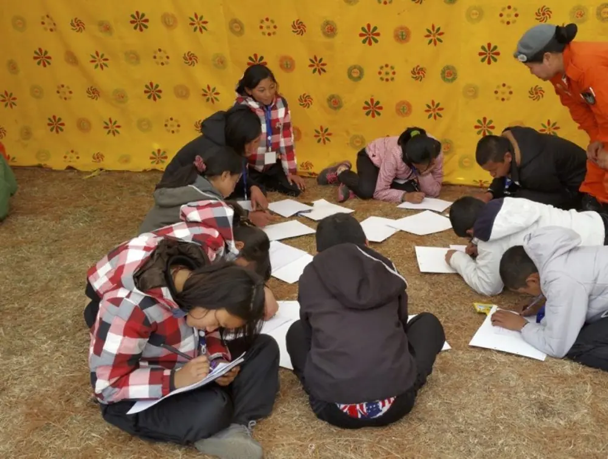
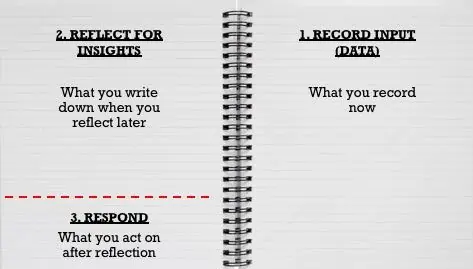
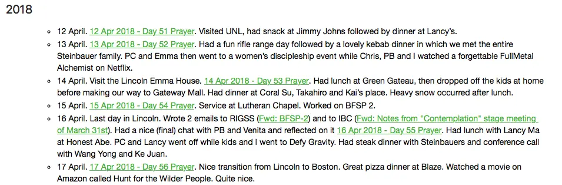

*Note: How does one create a daily practice of reflection and journaling? This is the second in a series of posts on how I teach and practice reflection and journalling. The first post can be found [here](https://adriansays.com/reflect-journal/). The third post is [here](https://adriansays.com/reflect-journal-drafts-versions/).*

 Getting Bhutanese Children to Reflect During an Experiential Learning Session

My interest in reflection began with a personal quest for greater meaning and purpose at work and in daily life. It wasn’t that life and work was meaningless then - it was just this nagging feeling that there could be something more to life than toil and labor. It's as if I was missing something else important all my life.

This earnest quest for a greater meaning became a lifelong pursuit that continues even today. It infuses everything that I undertake to do. Even my PhD, which was an inquiry into different approaches for leadership development, took on a more reflective orientation. Its eventual title was “Reflecting on Experience for Leadership Development.” The dissertation allowed me the space to explore the different ways people reflect in different professions and situations. I discovered how differences in the way one reflects can lead to growth or stagnation in one’s development. (If you are interested to read more about my dissertation, you can find it [here](https://digitalcommons.unl.edu/cgi/viewcontent.cgi?article=1010&context=businessdiss))

I discovered that while many leaders I encounter acknowledge the importance of reflecting and journalling, not many know how to do it well, or to maintain the practice consistently. When I started teaching leaders how to reflect, I also noticed a disconnect between how they reflect and journal and how the practice ought to influence the way they think, decide and act.

###  

### Breaking It Down

In order to help leaders strengthen this connection between reflection and action, I devised the simple heuristic of RECORD-REFLECT-RESPOND. When teaching leaders to think and act from data-driven reflection, I modified the popular Cornell note-taking system, which was designed to help students take notes in class and be more reflective in their approach to learning. I re-purposed the template to break down each step in the RECORD-REFLECT-RESPOND process so as to be more deliberate about the practice. Using this modified approach to journalling also helps leaders focus on the micro-skills of observing, listening and noticing behaviors and treating them as data for decision making.

 

####  

#### **AN ILLUSTRATION**

Here’s an example of this process at work which is leading me to change the way I display physical affection with my children.

#### *RECORD*

This morning, while recording some reflections, I noted that last week, during tea, we had an opportunity for a family photo shoot with the guests. I noticed that my son shied away from being in the picture. I also recognized that now that he is all lanky in his teens, I have not hugged him as much as I would. Additionally, I noted that on occasion in the morning, when he gets out of bed, he sometimes comes to me for a hug. Finally, I am also realizing that the only times these days that I put my arms around my kids are for photo ops (assuming that he even agrees to be in the photo).

#### *REFLECT*

Thinking about this series of behaviors, I wonder if I have been transmitting the wrong signals to my son regarding physical expressions of love. I wonder if part of the reason why my son is camera shy could be due to his self-image, which may potentially be affected by the reduced displays of affection from his father. I thought back on my expressions of affect with my elder daughter, and I noticed that I too, started to avoid hugging her when she went into puberty. Perhaps my son noticed that unconscious shift from me as well.

I do not want to transmit a wrong sense of how to be physically expressive. Upon reflection, I realized that it was me who felt awkward hugging my teenage son and daughter and that self-consciousness from me is projecting to them the wrong message about displays of affection between family members.

#### *RESPOND*

I need to clarify within myself what is and what is not appropriate public displays of affection. I need to be more purposeful about role modelling the desired behaviors.

### Waking Up Earlier Each Day To Reflect And Journal

One cannot reflect and journal consistently without changing one’s daily habits. To train oneself in the new micro-skills of observing, listening and noticing, one must practice daily.

I have experimented with doing my reflection and journalling in the mornings, evenings or whenever pockets of time become available. While there is still an element of personal preference, these days I simply wake up 30 minutes earlier than usual to reflect. It’s the window most within one’s control, and does not interfere with quality sleep (which I find reflecting before bedtime often does to me).

To help me maintain this habit, I make use of external reinforcements. Some time back, my church embarked on 40 days of communal prayer in which people commit to waking up early in the morning to pray. I joined that and used that time to also reflect and journal. Even though that communal event has ended, I have acquired the habit of waking up early. As of today, I am on Day 93 from that communal event.

### Making Use of Tools

When teaching leaders how to reflect, I first ensure that leaders understand and practice each step of the RECORD-REFLECT-RESPOND. Next, I help them acquire the habit of waking up earlier on a daily basis to reflect. Once the principles and micro-skills are internalised, I graduate them from the modified Cornell template. I then encourage them to explore what works for them in how they journal, as long as they continue to adopt the RECORD-REFLECT-RESPOND heuristic.

My own system of journalling these days involve the use of Evernote. It has a system of hyperlinks between notebooks and notes which allows me to record daily events and reflect deeper on each event. By tagging each reflection, it allows me to search and reflect on trends and patterns in my life, thereby allow me to engage in higher-order learning.

 

 Sample Record of Daily Events from my Evernote account

 

 

These days when I train leaders, I wait until they have habituated daily reflection and journalling before I proceed to work on the quality of their observation, recording and reflecting.

#### In the [next](https://adriansays.com/reflect-journal-drafts-versions/) post, I will share how to refine and harvest your reflections for more purposeful decisions and actions.
