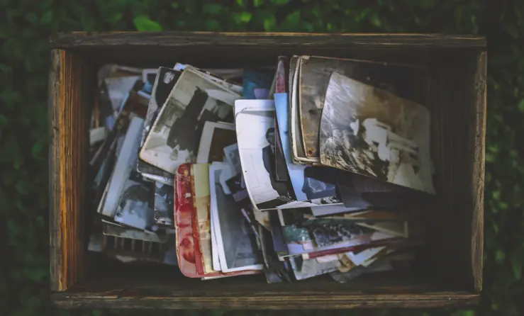
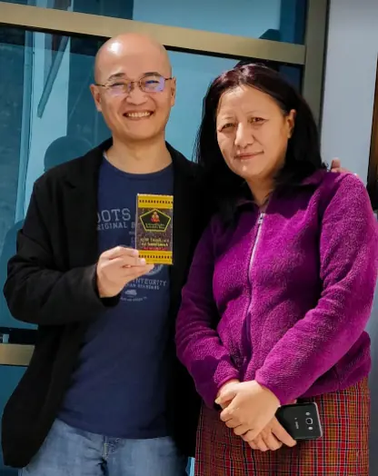
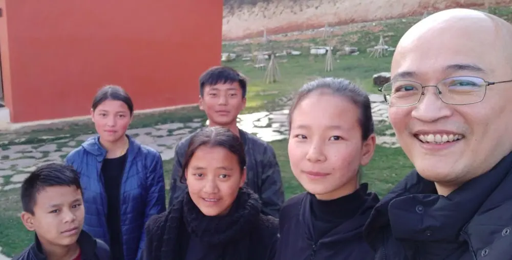
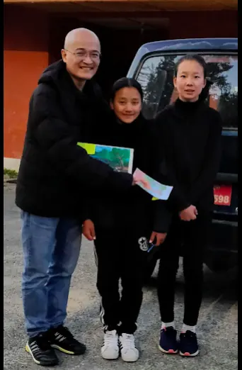

# 

# Why Do We Remember?

*"Who are we, if not our memories?” (Dennis Prager)*

Human memory is such a funny thing. Three nights ago, I had a conversation with a few Dashos on what they remember about Bhutan of old  and what we can learn from them. Watching them interact was intriguing, as they collectively reconstructed the most likely version of how things actually transpired.

# Memory Recall vs Reconstruction

Human memory is less of recall, and more of reconstruction. How we remember is even thought of as an act of [creative reimagination](http://www.human-memory.net/processes_recall.html). We can never aspire to any level of reliable recall without immediately recording an experience as soon as possible. More often than not, in recall, we are reliant on impressions, moments and snippets to trigger the brain to stitch things together from imperfect bits of information.

A recent email conversation with a colleague at RIGSS illustrated this quirk of human memory. In our emails, we went to and fro on “I recall this” vs “No, you said that”. It made me wish I had taken notes and had sent them along before I moved on to the next busy thing. Without such records, all we have is imperfect recall and a whole lot of frustration regarding what was actually said.

## Journaling and Reflecting from Good Data

To help me remember, I rely on my journals. Each day, I record what transpired as factually as I can. Then I use the data captured within as a basis for reflection. Without good data, it is impossible to have good reflections. If one only has impressions and snippets to work from, one ends up with rumination, skewed extrapolations and possibly a lot of angst over something more imagined than real. For reflections to be productive, one must first learn to capture data accurately and objectively. (For more on how to reflect and journal, please see [here](https://adriansays.com/reflect-journal/) )

## Event History Calendars

At work, I sometimes deploy a tool called an “[Event History Calendar](http://methods.sagepub.com/reference/encyclopedia-of-survey-research-methods/n168.xml)” to help people process their experiences for lessons learnt. Again, the focus is on the veracity of the connection between memory and conclusions drawn. And because the analysis process is recorded, it can also be verified.

For organisations wanting to make sense of a collective experience (e.g. a product launch, or a key share holder meeting), the event history calendar is invaluable for demystifying what actually transpired. One soon discovers that a ‘collective’ experience is not really that collective at all. What each person takes away from the common episode is different. Just as it takes many unique snow flakes to make a beautiful snow fall, so too, it requires skilful stitching of individual unique experiences to allow for the common phenomenon to emerge.

# First Encounter With The Royal Academy

My first encounter with the children at the [Royal Academy](http://academy.bt/) was on 29 Jan 2016, when I designed a 1-Day Befriender session for teacher Desuups to engage with them. Back then, their zest for life in spite of the hardships they endured had already won my heart . (*I still vividly recall one boy’s reflections on why that day was so special for him. He said it was the first time in his life that he tasted two different curries in the same day. I remember crying when I read that reflection. Much as I did not enjoy curry, that night, I resolved to give curry a go for the time I was going to be in Bhutan.*)

Two months later, on 25 Mar 2016, after they formally enrolled at the Royal Academy, I visited the children again, this time with my family. My daughter, Emma, was invited to a dance that the girls were rehearsing in honour of the birth of the Gyalsey. My son, Chris, had wanted to play soccer with the boys but decided to watch from the sidelines on account of his asthma.

## Perfect Memory? I think Not!

If you think I have perfect memory, I don’t. I am relying on notes taken of each visit to the Royal Academy.

In the process of reviewing these notes, I discovered that my association with the Royal Academy extended much earlier, to 2014, when I delivered a teacher-training workshop to the first batch of teachers for the Academy. Four years later, a participant, Tim Huang, shared his reflections with me and that was how I ‘remembered’. Sadly, because I did not reflect on that workshop, I never grew from that experience. If not for Tim's reflections, I would not even have recalled that encounter.

# Latest Encounter with The Royal Academy - 15 October 2018

Yesterday, I visit the Royal Academy again. Nobody invited me. But I went anyway, because it was easier to apologise later than to miss out on an opportunity to say goodbye to the children properly.

When we relocated back to Singapore on 7 July this year, we could not fit a farewell visit into the schedule. I felt sad that I should leave Bhutan without saying goodbye to the children. Hence, this time, armed with chocolates bought from Yiga, I made my way up to Pangbisa.

## The Significance of Yiga Chocolates

 Kinley, the kind Founder of Yiga Chocolates who donated chocolates for my Royal Academy visit

During students' tea break, I got my student guides to distribute the [Yiga](https://www.facebook.com/BhutanChocolate/) chocolates to the entire cohort. Kinley, the [entrepreneur](https://bhutantimes.com/article/bhutanese-artisanal-chocolates-infused-with-exotic-local-ingredients) who started the first artisanal chocolate business in Bhutan, had donated many chocolate bars when she heard that I was visiting the Royal Academy. Her courage to pursue her own dreams was a story worth telling, so I shared her story with the children.

For the next few minutes, I encouraged the children to journal about their dreams and to keep refining those ideas by sharing their reflections and seeking [feedback](https://adriansays.com/feedback/). I told them that just as the chocolate is a gift, so too is feedback. I encouraged them to write home to share their dreams with their own family members. ("Even if some of your parents may not know how to read, the fact that they received a [letter](https://adriansays.com/letters-spouse/) is like you receiving your chocolate"). Then I conveyed my hope that they would have the courage to pursue those dreams, just as Kinley has done. Who knows, one day, their dreams will bless others, just as Kinley’s chocolates have blessed them.

## My Guides from Royal Academy

 From Left to Right: Dechen Lhendup, Kinlay Yangzom, Chimi Wangmo, Tandin Wangchuk, and Sonam Tshomo

By the way, my student guides were fantastic! Dechen, the youngest, was initially shy but bravely performed his ushering duties nonetheless. Kinlay, the 2nd Year guide, is into athletics (She jogs five km nearly every day). The other male guide, Tandin, was enthusiastic when I asked him about his favourite sport (Ans: "Football. We play it every day!"). Chimi and Sonam were from the first batch of students and did most of the talking, role-modeling for the other three how to be student guides.

As they showed me around the campus, poised and practiced, they patiently answered my queries. (Q1: "*How many pairs of shoes are you allowed?*" Ans:“*Two pairs, but sometimes they increase when my parents visit.*” Q2: "*Which dorm do you think is neater?*" Ans: "*The girls dorm.*" Q3: "*Do you continue to stay awake after lights are supposed to be out?*” Ans: *Giggles*)

During tea break, Chimi fetched tea for all of us while Sonam ushered me to my seat. When I asked for help with distributing the chocolates, they all quickly took over, counting and dividing up the chocolates bars for equal distribution to the rest of the children.

While sipping tea, I threw more questions at them. (Q1:“*Do you get into quarrels*” Ans: “*Yes, I ignore him for a day and then I apologise.*” Q2:“*Do you like anyone from the opposite sex?”* Ans: “*No, we all treat each other as Achos and Ashims. But occasionally we get teased and it is not helpful.*”)

The Royal Academy has done something right educating them. (By the way, they are hiring! See their [website](http://academy.bt/) for more information)

## Guides Who Remember

Towards the end of the tour, Chimi suddenly turned to me and asked, “*How is Emma*?” I was so surprised that she would remember Emma that I stopped in my tracks. She said that she still remembered the time together with her at the rehearsal dance for the Gyalsey and that she had painted something for her as a gift. I don’t know why my teary eyes and runny nose acted up so suddenly then. Must be the Pangbisa air.

## Visitor Who Forgets

I said my goodbyes to the teachers and the students. Feeling happy, I was halfway down the mountain when I realised that I had forgotten something. Chimi had told me to wait for her while she went to her room to retrieve the gift for Emma. And I had completely forgotten all about it!

I hurried back to the Academy to find her waiting patiently for me at the car park. Her fellow guide Sonam had also waited with her, armed too with her own present for Emma. Not trusting my faulty memory to recall this occasion, I asked my driver to snap a photo for us to capture the moment.

 Chimi and Sonam

# Human Memory is Unreliable

A Jewish scholar by the name of Dennis Prager writes of God as a God who remembers. By his definition, God remembers perfectly. By this, I take it to mean that He encodes each detail of our lives perfectly, and will also retrieve every detail perfectly when our lives are flashed before our eyes. How He acts on the remembered details is also perfect. He is unlike me, who suddenly ‘remembered’ that I had left something behind and had to spring into reverse gear to head back up the mountain.

I have often asked myself, ”If God is good, why does he allow evil to persist? Why doesn’t He act according to MY timing?”

I don’t know. Prager cites the medieval Hebrew saying: “*Lu yidativ, hayitiv*” “*If I knew God, I’d be God*”. I suppose. But now I know better. If action is based on timing and timing based on remembering, then I am thankful that God does not act according to my sense of timing. My remembering is too leaky, my reflections too influenced by imperfect data and my personal opinions of what is right and timely is too imprecise to be trusted.

# Remembering for The Future

Nonetheless, one thing I do know. My visit to the Royal Academy happened at a good time. I reconnected with the children. I managed to say my goodbye to them without making it come across as a final farewell. As a bonus, I even managed to deliver the first ever Bhutanese chocolate bar with a worthy story behind its creation.

It’s been a while since I posted something on this blog. I thought there would be a nice silent retreat to look forward to in my two weeks here in Bhutan. This trip has been anything but 'silent'. Each day has been filled with encounters, tabled or unplanned, with various people. Though I've only shared publicly here about the Royal Academy visit, each of my conversations has been a gift to me in different ways. To make sure that each encounter is properly honoured, I've been journaling about them. This way, each person who touched me, though anonymous for now, will nonetheless occupy a place in the future me.
