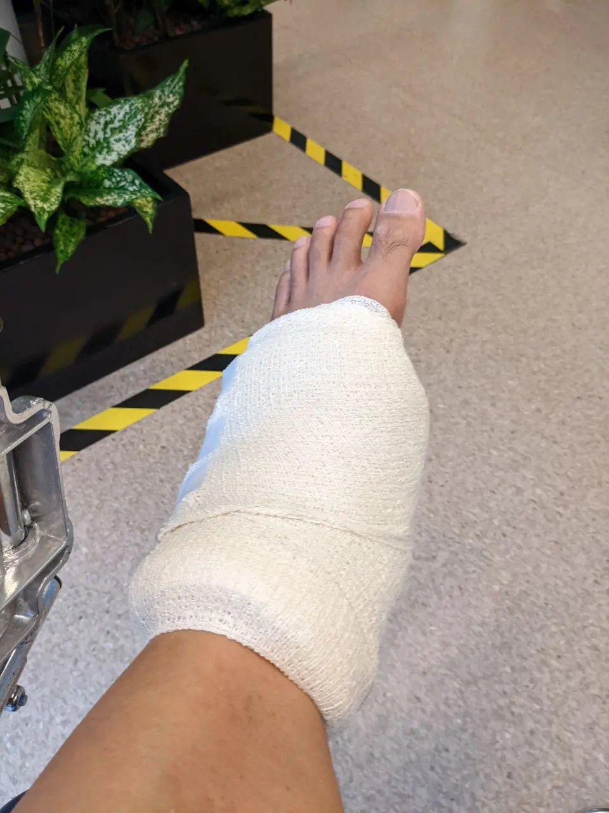

My [Jones](https://online.boneandjoint.org.uk/doi/abs/10.1302/0301-620X.68B5.3782244) Bandage

"I mean it when I say I want to serve u, so please make use of it. :)" A friend of mine sent this message to me a week ago. It has perplexed me ever since.

## **A crippling work situation**

Backing up a bit for context, I have been on crutches for the past month. It's probably some kind of ligament injury on my ankle that flared up again because I have not been taking care of my body and allowing it time to heal. (But that is a lesson in itself for me to share another time.) As such, I was forced to reschedule appointments, say no to good things, and basically slow down.

Needless to say, the past month has been much less productive. I could not do my usual walks or cycle to unwind. My one good leg almost threatened to quit on me at one point. My lower back almost followed suit.

Thankfully, I had great colleagues who took turns to nag, help, adjust and scold me. My prayer transformed from "Lord, heal me so that I can get back on my feet!" to "Lord, help me go through this, for even in this season of being crippled, there are lessons to learn and loving to give and receive."

## **I want to serve you!**

So when my friend heard about my situation last week, he sent me the text. Since then, I've been perplexed (in a good way, of course!) in terms of how to respond. Instead of the more superficial "Get me chicken wings!" or "Drive me to this or that meeting," I realised that even in this, there is a lesson for me.

In fact, he was not the only person who echoed similar sentiments to me. Before I went on crutches, there have been a few more people who said something similar to me. The fit/independent me back then likewise did not know how to honour such sentiments from others. But now that I had more time off my feet, I could ponder more clearly how to respond to people who willingly, lovingly submit themselves to the needs of others. 

It also made me realise that I have beside me a loving wife who not only said similar vows to love and serve, but is living them out on a daily, thankless basis. (Note to self - being lame does not excuse one from showing gratitude and love to others. Not doing so would be truly lame).

## **Is the work you give out life-giving or life-draining?**

Have you ever thought about the work that you give others to do? Does it leech the soul out of life, numbing the senses and sense of being in the recipient? Does it create a sense of [languishing](https://adriansays.com/motivation/) in others?Or is your work is life-giving, enriching in the recipient the resolve to be better versions of oneself?

Do we even know the impact of the work we give out? Or do we care? Maybe because the work we receive from others are life-draining, we kick the can down the road, and kick the dog because that's how it is at work? Or maybe we console ourselves and try to dissociate work from self. Yet somehow, "it's just work" doesn't seem to quiet the rancour within when we are drowning in life-draining work. This is why we must do better regarding the work we get and give to others.

## **Designing work that serves the needs of others**

Coming back to my loving friend who wanted to serve me, I'm still pondering about how he can be helpful in a way that honours his spirit and enriches his journey. Although he was demonstrating care for a neighbour and a brother, it was also, for me, a reaching out for noble work that gives life to both parties. And that made me think about the kinds of work I give to others, and what I can give specifically to him.

In this, I'm reminded of my Heavenly Father who knows how to give good gifts to His children. These gifts include the gift of labour. He designs good works in advance for us to fulfil. Through this season of being off my feet, I'm glad to have caught a glimpse of how my Father in heaven labours, for He is infinitely more thoughtful than I can ever be.

Although there are times I can barely finish the work assigned to me, I am now more inspired to consider how I design good work for others. It means I have to keep the [LAMP](https://adriansays.com/take-care-of-your-lamp/) lit for myself and others. It will take more effort, but I am sure I can only get better with practice.
