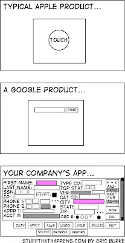

*`Simplicity in Creation: Photo by Emma Chan (@datsi_shoots)`*

**UPDATE**: *I will be giving a webinar on this topic on 30 Apr 9am to 10am as part of a panel series on Leading Through Crisis hosted by DM360. Donations are welcome and all donations received will be channeled to helping the migrant workers in Singapore. For registration, please go to [here](http://tiny.cc/DMTalks2).*

## **The Call to Simplicity**

In life, we will encounter many calls to simplicity. It can come from a health warning concerning the harms of our excesses. Or it can come from an epiphany concerning the futility of these excesses. It can be brought upon by choice or by circumstance. With COVID-19, it appears that we have both the option of choice and circumstance to move us towards simplicity.

## **What is Simplicity?**

Simplicity simply means being simple. It means one is clear about one’s purpose, about what is needed for the here and now, and how to achieve it. Being simple has nothing to do with being simple-minded or stupid. On the contrary, to be simple is to be so clear in one's thoughts that one cuts through the clutter. It is to “*eliminate the unnecessary so that the necessary can speak*.” (Hans Hofmann). 

For some of us, with our daily tech-enabled info overload at work, we sometimes feel unable to disambiguate. Now that COVID-19 is forcing a pause, we no longer have an excuse to be unclear. Whether on an enforced quarantine, or on self-isolation, now is the time to make use of time to seek clarity around what we work for and why. It is time to arrive at a COVID-fueled simplicity.

### *Simplicity at the workplace*

Simplicity is of great value for the workplace. It means one is focused and aligned to activities that generate value and avoiding what does not. Here is a simple illustration of simplicity by Eric Burke. How long did you think it takes for a successful company to get to that level of simplicity? Is their simplicity "simple-minded", or is it razor-sharp (and hugely profitable?)

*Simplicity in Places of Worship*

Churches are a particular type of workplace, as well as places of worship. These days, with COVID-19 safe distancing, churches are all emptied out. Congregants no longer congregate. Church-goers no longer have churches to attend. All is quiet on the crowd front. With no Sunday events to prepare for a consuming mass, the way towards simplicity is now clear.

Service no longer refers to liturgy or order of events held within auditoriums. No longer does it refer to slick musicals to present to a passive audience. Safe distancing has forced a reflective review. Why use a band if a single musician suffices to usher one into a posture of worship? Why enact elaborate dances and orchestral performances when it is the call to worship that we desire? If the primary role of worship leaders is to encourage a posture of worship in others, how can this be done without invoking mega production budgets and efforts if simpler approaches would suffice? 

On a different day, such a thought would invoke consternation amongst artistes who are also worshiping God through their performances, and the congregants who expect and appreciate the spectacle as a staple of worship. Well, what could not have been done through any normal change effort has now been achieved through COVID-19. Worship has gone back to the basics, back to “the heart of worship.” And it is beautiful.

Simplicity extends not only to how we worship God, but also to how we express our worship of God in upholding justice and practicing mercy. With simplicity, service literally means just that - how we are to serve others. Likewise, single-minded simplicity is breaking down ministries that have grown fat and inward looking over time. Ministries are returning to their roots of ministering to those in need. Whether it is handing out free masks, free meals, or heartfelt messages of encouragement to front-line workers, being involved in church has been made simple. It is not about maintaining an institution. Rather, it is about what we do with others for others.

### *Simplicity as a lifestyle*

Simplicity must also be expressed at home. Now that COVID-19 is forcing us to stay at home, there is no better time to review how we are at home. Are we clear about what home and our lifestyle is about? What does a typical day at home reveal about us? Are we fully present now that we are physically forced together? Is that creating strain due to existing or newly discovered fissures in relationships? 

For me, a good test of simplicity is not how many assessment books one manages to get one's kids to complete at home. After all, most of our kids will eventually go back to school. But for now, they have an unprecedented opportunity to have extended family time. Hence, simplicity at home should result in a determination to create beautiful shared memories with our family members. 

### *Simplicity in our use of time*

Simplicity is not only cultivated over time, it starts with time itself. With an enforced stint staying at home, technically, we have more time now after eliminating travel time. So what are we doing with the extra time? What does how we spend our time reveal about us? If we are to categorize how we spend our time, how much of that would be "consumption"? How much would be "production"? And how much would be "self and other actualization”?

Simply put, time is of the essence. We must make moments matter. We have no time to lose, for we do not wish for this COVID-19 pause to last forever. 

## **Simplicity through spiritual disciplines**

To achieve simplicity in all these arenas, one has to adopt certain disciplines. When we do that, we consume what we need, achieve contentment with what we have, and channel everything else to realize the sense of purpose in self and others. 

Spiritual disciplines enable us to get from point A to point B. These disciplines may not make sense in and of themselves. But it is the exercise of these disciplines that allows us to attain mastery. I like to think of spiritual disciplines as spiritual dumbbells. Accumulating a wide array of these dumbbells does nothing except to occupy space. It is the regular exercise using these disciplines that allow me to become fit.

## **Steps towards simplicity**

Every spiritual discipline comes with exercise instructions. Here are some simple steps for attaining simplicity:

### *Trim out the excess*

If we can have a meal with 2 dishes, why have 5? If we can do with 2 meals a day, why have 5? Or if we can eat a simple meal, why go for a more elaborate one higher up the food chain that strains the gut?

To have excess is to either have an over-concern with not having enough, or an overindulgence due to having too much. Underlying both extremes is a psychological pathology of over-hoarding, over-focus on self, and over-reliance on external validation. It is not about whether one is too fat or too thin. Rather, it is one state of mind concerning one's grasp on all things material. Do you have a firm grip on what you really need? Or does the material stuff have a firm hold on you? 

### *Temper the appetites*

If we have to indulge in an occasional video binge, let’s at least exercise some restraint in how we stream the videos. If we can make do with 360p streaming, why go for full HD or even 4K? Let’s save some bandwidth. Better yet, reduce the video binge and read a book instead. (refer to how to read). You will find reading and reflecting healthier than popcorn popping and couch potato-ing.

Our appetites constantly wage a war against our souls. The stomach is our god, and its constant demands make slaves of us all. Which is why fasting is so crucial. A regular habit of fasting arrests the appetites. By varying our fast, we can balance health concerns with the need to wean off our indulgences to our appetites. 

### *Tithe your time*

Everyone of us has 24 hours in a day. Much as we like to think we own our time, we don't. The best we can do is to make sure that the time stream does not slip through our hands without us having weaved something useful with it. Learn to live in blocks of time. 3 blocks of work for a block of rest. 6 blocks of workdays for a block of sabbatical rest. A regular tithe of time to rest allows one to rest from work and to work from a place of rest. 

### *Train your mind*

[Read](https://adriansays.com/reading/) regularly. [Reflect](https://adriansays.com/reading/) deeply. [Relate](https://adriansays.com/reading/) widely. Find it within yourself to empathise with the experiences of others. Train your mind to explore contrasting viewpoints until their limitations are exposed. Remember to be circumspect while in training, for there is nothing more dangerous than half-formed insights. Above all, be gentle with others. What is exploration for us may come out as indictment or an unwarranted critique for others. If you can, find a coach and a mirror to help you. (If you need one and are willing to pay for one, I'd be happy to offer my [services](https://adriansays.com/reading/) in this regard)

## **Simplicity has eternal value**

There is a beautiful [song](https://www.youtube.com/watch?v=xrusZ-MkTn4) by the Rend Collective about child-like purity in simplicity. It's beautiful. To paraphrase Confucius, faith is simple. It is Man who complicates things. To the children, Jesus beckons, "*Let the children come, for the Kingdom of God belongs to such as them*.” 

I suspect that life itself is a journey to shed ourselves of sophistry, and to discover the simplicity that suffices. At the end of life, with our dying breath, many come to realize that all that glitters is not real gold, that when shorn of our many layers, there is a core within us that God weighs to determine if we have what is truly necessary for our journey into the Great Beyond. Let us not belatedly realize then that we have been barking up the wrong tree. Lest we end up in the wrong Eden, let us henceforth be clear - let us strive for simplicity. 

## Afternote

The Wife remarked that for a post on simplicity, I used many ‘chim’ words. Guilty as noted. I am definitely a work in progress. (Chim - Singlish for sophisticated, or in this case, bombastic. Oh. There I go again. Let me rephrase. Any words that have more than 3 syllables can be considered ‘chim').
