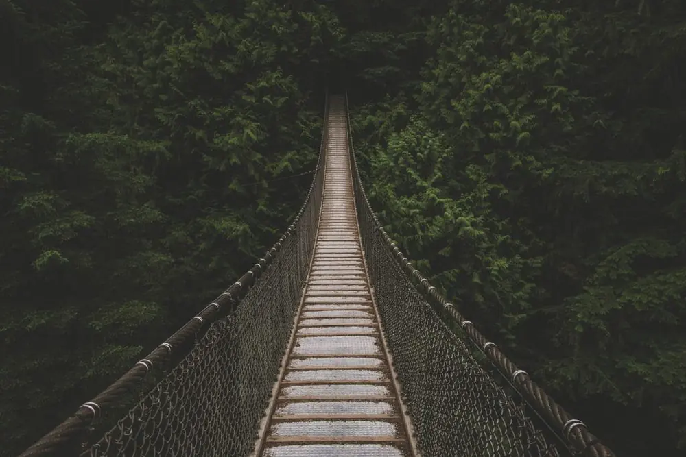
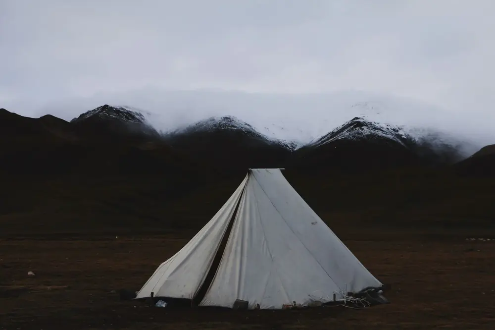

# 

# Transitions: A Common Experience not Commonly Talked About

I don't think we pay enough attention to what goes on when someone is in transition. For example, in the past month since [relocating](http://adriansays.com/whatever-happened-to-monday/) back to Singapore, a common question I am asked is, "So have you settled in yet?" Sometimes, I am tempted to say "Yes" just to get on with the conversation, because the real response will take too long to elucidate and I am not sure if the person is really interested or keen to understand. If one has not undergone transitions, it is hard to empathise with the transition experiences of others. Coming back home from a holiday does not count as a transition. I discovered it for myself when I felt the drastic difference between this particular homecoming and the other times I was back in Singapore for a holiday. This time round, I had more to unpack than just my bags. There is much shedding and seeking, much resolving and rediscovering. There are things to let go of, which may fill one with gratitude or grief to mark its passing. Each new day in Singapore inundates me with daily experiences that somehow feels familiar and yet alien at the same time. On occasion, it can be a struggle to decide whether to succumb to the "Singaporean-ness" of things or to stand firm against it. Thankfully, this transition has not resulted in a crisis of identity for me, although it has brought me to a certain [desert](https://adriansays.com/index-php-2018-08-20-desert/) at times. Having prepared myself for this return, I am allowing nature to take its course. I am resisting the old me, with my preponderance to jump right into things, to over-plan and structure exactly how things should flow. Now, I am much more able to enter into my own state of [flow](https://positivepsychologyprogram.com/mihaly-csikszentmihalyi-father-of-flow/). I am also much more adept at managing my own "mono no aware" moments (a beautiful Japanese phrase that describes the impermanence of things and the gentle wistfulness of their passing).

# A New Word for the New Season

In adopting a new posture for peace during this transition, I have also experienced the inadequacy of words. Specifically, English words. A friend of mine recently posted on Facebook that she was not able to find a good English word to describe the feeling for a particular situation she is in. I think I can understand. I am realising that English words are not as potent on their own as I have imagined them to be. Instead, they rely on the companionship of phrases in order to convey a greater gestalt. There I go again - *Gestalt*....a German word that finds its way into the English language because "something greater than the sum of its parts" seems like an awkward rendering in comparison. These instances are more common than expected. And we are complicit when we use the same word such as "Love" to describe anything from sublime affect to a tennis score, and to almost anything in between. Maybe that is why Trump tweeted 'Covfefe' more than a year ago which led to a [kerfuffle](https://www.npr.org/sections/thetwo-way/2017/05/31/530861002/trump-asks-who-can-figure-out-covfefe-and-the-internets-hands-shoot-up) (a Scottish word, not English) - perhaps he too was at a loss for words at that time.

# Finding That Word

So I too have been struggling to find words to describe where I want to be with regard to my new work in Singapore (as in not a job but a contribution and a response to a call. I think the Latin word I am looking for here is "*vocare*"). In the search to give form to feeling, I resorted to acronyms in a vain attempt to make the collection of words more elegant (see section at the end). Sadly, we no more own words than we earn the air that we breathe. Words, like the air around us, are an unmerited gift. Each breath we breathe should be inhaled with *yugen* (an awareness of the universe that triggers emotional responses too deep and mysterious for words) and exhaled with *gratitude* (a word that is gradually losing its place these days). So it is with much gratitude that I recently found a beautiful Hebrew word that seems to describe more succinctly the 'vocare' I want to be in. That word is "*Avodah*".

# Avodah

Like an incantation, this Hebrew word sounds so mysterious when pronounced! And it is a good thing, because I need it to be a personal invocation for me. The original meaning as used by the Hebrew is an interweave of three distinct meanings threaded together to give greater texture to the fabric of life. It conveys worship (or prayer), work, and service. That the Hebrew would use a common word to describe these three ideas hint at a deeper level of life practised by these ancient people. One's worship of God is articulated in one's work. To work is to serve. And in service we find our rightful worship. All labour becomes a dignified expression of worship. As a result, worship is no longer walled within by the separation of church and state, but worked out as a daily offering of excellence through worthwhile endeavour. Work is not what we worship, but how we profess to worship. Work becomes redemptive, transforming us from workers to worshippers. It allows us to reverse the reductive effect of being labelled as "human resource" to be utilised. Instead, we transcend to take up our rightful identities as the unique, work-in-progress masterpieces we are, wonderfully made, crafted to create. It liberates us from a contractual employment on earth to a perpetual deployment of our gifts for this good earth, wherever on earth the work brings us. In so doing, we release our clutch on an illusive iron rice bowl, and take hold of the divine assignment to be living vessels for a greater work.

# Transition into Meaningful Tent Making

And so this is where I want to eventually be when I conclude my transition. To practice my avodah as a meaningful form of tent making.  *The Tent is a place where a sojourner rests for the night.* *It shelters me from the elements, and lets me travel light.* *It helps me journey further, anchored but untethered.* *May those who travel with tents find similar respite.* My TENT allows me to

- **T**end to the Temple
- **E**xpress Expertise
- **N**avigate and Nurture
- **T**ithe My Time

## Tend to the Temple

- My body is the temple of God
- I must be in top shape physically, emotionally, relationally, and spiritually to tend to the temple
- I must earn enough to pay for upkeep of this temple

## Express Expertise

- We are all uniquely shaped to serve
- In fulfilling my assignments, I am to bring my unique contributions into play
- In working together, I must bring others’ expertise into play

## Navigate and Nurture

- It’s about the People. Nothing I do matters if I do not bring good to people
- It’s about the Purpose. Nothing I do means anything if I cannot address the needs of the now and focus for the future
- It's about the Prospects. Nothing I do makes sense if I am unable to navigate and nurture for a better tomorrow

## Tithe my Time

- The [time](https://adriansays.com/death-at-70/) I have on earth is something I need to steward well
- I will offer a sacrifice that costs me something
- I will observe my special tithe: My Sabbath of Rest
